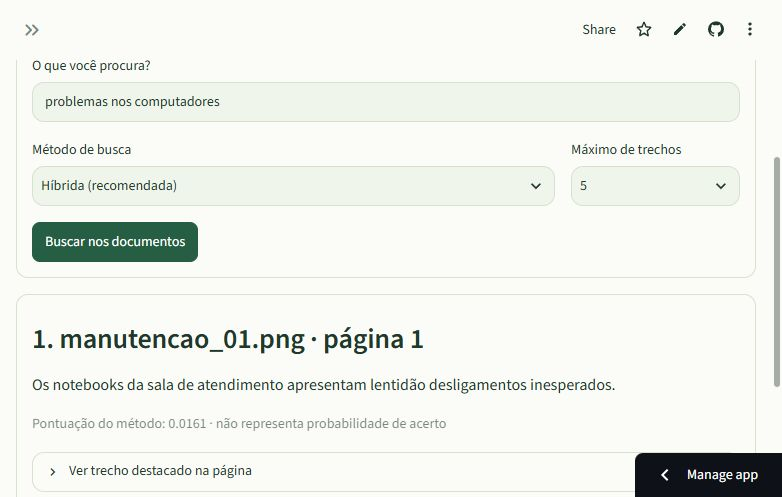
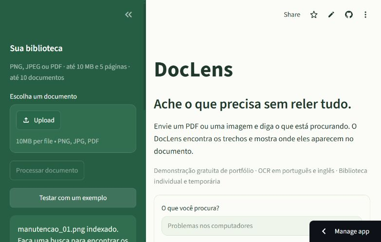
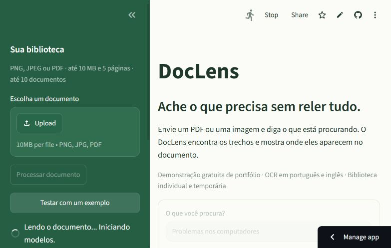
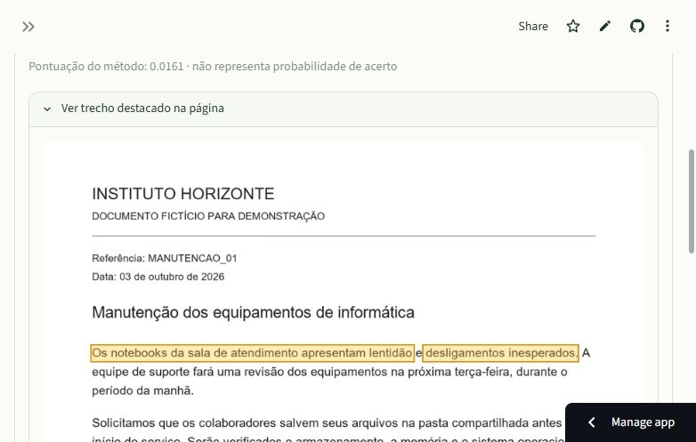

# DocLens

**Ache o que precisa sem reler tudo.**

O DocLens ajuda a encontrar informações em documentos, como memorandos e comunicados.
Ele reconhece o texto de PDFs e imagens e permite pesquisar por assunto, mostrando
os trechos encontrados e sua localização na página.

[**Experimente a demonstração online**](https://doclens-app.streamlit.app/)

## Como funciona

1. **Adicione um documento:** envie um PDF, PNG ou JPEG, ou clique em **Testar com um exemplo**.
2. **Pesquise o que precisa:** escreva uma palavra, um assunto ou uma frase. A busca combina
   palavras e significado para encontrar trechos relacionados.
3. **Confira a fonte:** veja o arquivo, a página e a passagem destacada no documento.

Por exemplo, ao pesquisar **“problemas nos computadores”**, o DocLens pode encontrar
um comunicado sobre manutenção de equipamentos, com um trecho sobre notebooks
que apresentam lentidão e desligamentos inesperados.

## Veja na prática

Capturas da demonstração online em Streamlit, usando um documento fictício.
A interface da versão local tem um layout diferente.



<details>
<summary>Ver mais prints: envio, leitura e destaque no documento</summary>

**Envio de documentos e biblioteca**



**Leitura automática do texto (OCR)**



**Trecho destacado na fonte**



</details>

## Para experimentar

Na demonstração online, use arquivos de teste de até **10 MB e cinco páginas**.
Cada visitante tem uma biblioteca temporária, que pode ser apagada ao encerrar a sessão
ou reiniciar a aplicação. O primeiro processamento pode demorar enquanto os modelos carregam.

Para executar a versão local, instale o [uv](https://docs.astral.sh/uv/) e, na pasta do projeto, rode:

```powershell
uv sync --locked
uv run python -m scripts.prepare_models
uv run uvicorn doclens.api:app --host 127.0.0.1 --port 8000 --no-proxy-headers
```

Após a inicialização, abra [localhost:8000](http://127.0.0.1:8000).
A preparação inicial precisa de internet para baixar os modelos.

## Sobre o projeto

O DocLens é um buscador de documentos que reúne OCR, recuperação de texto e consulta à fonte. Na versão local, a interface web é servida pelo FastAPI; a demonstração online usa Streamlit.
Durante o processamento, PDFs são renderizados como imagens. O EasyOCR reconhece o texto e registra as coordenadas de cada trecho na página. O sistema organiza o texto em passagens pesquisáveis e salva os resultados e os vetores de busca no SQLite. A busca híbrida combina resultados por significado e por palavras. As coordenadas do OCR permitem destacar cada resultado na imagem original.

O projeto usa modelos pré-treinados e documentos fictícios. As avaliações medem o comportamento nesse conjunto de exemplos, mas não garantem a precisão em outros documentos. Confira sempre as passagens encontradas na fonte.

Stack: Python 3.12, FastAPI e Uvicorn no backend; HTML, CSS e JavaScript na interface local; Streamlit na demonstração online. O processamento de documentos usa EasyOCR, OpenCV, Pillow e pypdfium2. A busca usa Sentence Transformers e scikit-learn. O armazenamento é feito com SQLite, e as dependências são gerenciadas pelo uv.

Os detalhes das avaliações estão nos [relatórios de OCR](reports/results.md) e
[de busca](reports/hybrid-search.md). Código e documentos fictícios sob a [licença MIT](LICENSE).
Bibliotecas e modelos mantêm suas próprias licenças.
